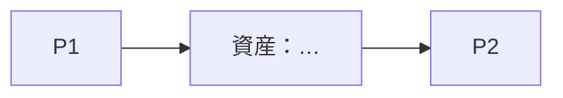

# research-program — テーマを論文の単位に切る

`research-themes` でテーマが見えたあと、`research-lab` の G1 の前後で使う。
出力は `~/research-lab/programs/<名前>/` の `program.md`（人が読む全体像）と `program.yaml`（系統・論文・プロジェクトの対応表、正本）。`rl program new <名前>` で作る。各論文は `research-lab` の 1 プロジェクトになり、`rl new <project> --program <名前> --paper <ID>` か `rl program link` で両方の台帳に紐づく。programs/ は git の管理外（公開リポジトリに入れない）。

## プログラムの形

```
幹（長期の問い。2〜3 年で答えに近づけばよい。1 文）
 ├─ 論文 P1（最初の 1 本。いちばん速く・安く出せるもの）
 ├─ 論文 P2（P1 の資産を使う）
 ├─ 論文 P3（P1・P2 の資産を使う。本会議・論文誌の候補）
 └─ 枝 B1（幹と独立に進められる保険。別の興味の掛け合わせ）
積み上がる資産（データ・部品セット・ツール・評価手順・現場との関係）
```

- **幹**は 1 つ。興味が 3 つあっても幹は 1 つにし、残りは枝か、論文の「軸」として入れる
- **論文**は、1 本が 1 つの反証できる主張と、それに答える 1 つの実験で書ける大きさ
- **資産**は、論文が終わったあとに残り、次の論文が使えるもの。資産が増えない並びは、積み上がっていない

## 切り分けの原則

1. **1 本 = 1 つの新しい軸。** 論文 1 本の中で新しくするのは 1 つだけ（課題・手法・測り方・機体のどれか）。他は既存のものを借りる。複数の興味の掛け合わせは幹でやり、各論文は 1 つの軸を新しくする。「A と B と C を全部入れた 1 本」は査読で「何を主張する論文か分からない」になる
2. **問いは「どこまで・どの条件で」の形。** 「できるか」は 1 回の成功で終わる。「どこまで・何が境目か」は否定的な結果でも論文になる
3. **最初の 1 本は、いちばん速いもの。** 実機の時間・予算・外部との調整が最も少ない論文を P1 にする。P1 の目的は、資産（環境・部品・評価手順）を作ることと、締切を 1 回通すこと
4. **依存は前にだけ向ける。** P(n+1) は P(n) の資産を使う。P1 が潰れても進める枝を 1 本は持つ
5. **投稿先から逆算する。** ワークショップ（4 頁、締切は本会議の 2〜3 か月前）と本会議・論文誌（8 頁、seed・試行数が要る）では、必要な実験の量が 3〜5 倍違う。締切の無い論文は進まないので、CfP が未定でも「この時期のこの系統の WS」と書く
6. **各論文に逃げ道を書く。** 結果が否定的・先を越された・実機が壊れた、の 3 つで「それでも書けること」を 1 行ずつ
7. **人が決める所を残す。** 論文の順と幹は提案し、選ぶのは人（`research-lab` の G1）。切り直しも人の確認のあとで

## 手順

1. **入力をそろえる**：`notes/themes-*.md`（テーマのカード）、本人の条件（ゴール・強み・制約）、競合の確認結果（`ml-lit-review`・`novelty-check`）。無ければ `research-themes` に戻る
2. **幹を 1 文で書く**：テーマの候補のうち、幹になるものを選ぶ。選べないときは 2 案出して人に決めてもらう
3. **論文の候補を並べる**：幹に答える論文を 3〜5 本、枝を 1〜2 本。各論文を下の表の 1 行にする
4. **依存と資産を描く**：mermaid の有向グラフで、論文 → 論文、論文 → 資産 の矢印を描く。矢印が後ろに向いていたら順番を直す
5. **時期を当てる**：投稿先の締切から逆算して、各論文の「実験を始める月」「原稿を書き始める月」を置く。本人の週あたりの時間で割って、入りきるかを見る。入らなければ論文を減らす（質は落とさない）
6. **潰す**：原則 1〜6 で各行を自問。原則 1 に反する行（新しい軸が 2 つ以上）は分割する
7. **書き出す**：`rl program new <名前>` で作り、`program.md` に全体像、`program.yaml` に系統（lines）と論文（papers）を書く。論文に着手するときに `rl new <project> --program <名前> --paper <ID>` でプロジェクトを作る（すでにあれば `rl program link <名前> <ID> <project>`）。`rl program readme` で program.md の状況の枠を更新し、`rl program check` で対応を確かめる
8. **見直す**：次のどれかで戻ってくる。論文が 1 本終わった／競合が出た／G1 が覆った／機材・時間の条件が変わった。見直しは `program.md` の「履歴」に 1 行ずつ残す（過去の版は消さない）

## program.yaml の書式（正本）

```yaml
program: <名前>
title: ""
lines:            # 系統。status: active | later | paused | dropped
  - {id: A, name: "", trunk: "<幹：長期の問い 1 文>", status: active}
papers:           # 1 論文 = 1 プロジェクト。status: planned | active | done | dropped
  - {id: P1, line: A, question: "", project: null, status: planned, depends_on: [], venue: ""}
```

- `project` は `rl program link` が書く（手で書かない）。プロジェクト側の `research.yaml` の `program: {name, paper_id, depends_on}` も同時に書かれる
- 論文が終わったら `status: done` にする。`rl program status` は、依存する論文が done でない間「依存の待ち」と表示する

## program.md の書式

```markdown
# プログラム：<名前>（<日付>）

## 幹
<長期の問い。1 文>

## 条件（research-themes から）
ゴール／強み／制約（週 N 時間、機材、予算）／実機の制約

## 論文の並び
| ID | 問い（1 文） | 主張の形（何が出れば言えるか） | 実験の骨（課題・比較・指標・規模） | 使う資産 | 作る資産 | 投稿先・時期 | 依存 | 逃げ道（否定的／先越し／機材） |
|---|---|---|---|---|---|---|---|---|
| P1 | | | | | | | — | |
| P2 | | | | | | | P1 | |
| B1 | | | | | | | — | |

## 依存と資産


## 時間割
| 月 | P1 | P2 | B1 | 本人の時間（週 N h × 週数） |

## 未確認（新規性・競合・機材）
- …（確認する手段と期限）

## 履歴
- <日付>：作成（きっかけ）
```

## research.yaml との対応

1 プロジェクト = 1 論文が原則。`research.yaml` に次を足す（書式は `research-lab/references/ledger.md`）。

```yaml
program:
  file: ../program.md        # または記録先のパス
  paper_id: P1
  depends_on: []             # 他のプロジェクトの名前
```

プログラム全体のノートは、最初のプロジェクトの `notes/` か、記録先（`rl config notes`）の研究フォルダに置く。

## やってはいけないこと

- 1 本の論文に主張を 3 つ入れる（興味が 3 つあっても、論文 1 本の新しい軸は 1 つ）
- 全部の論文が実機の時間に依存する並びにする（最低 1 本はソフト・シミュレーションだけで進むもの）
- 資産が積み上がらない並列の論文だけを並べる
- 締切の無い計画。CfP が未定でも時期を置く
- 「できるか」の問いのまま計画する（否定的な結果で書けなくなる）
- 幹を 2 つ以上にする。興味を全部幹にしない
- 人の確認なしに幹や論文の順を確定する
