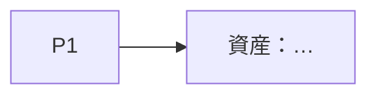

# プログラム：{{PROGRAM}}（{{DATE}}）

<!-- 書き方：~/research-lab/skills/research-program/SKILL.md
     系統・論文・プロジェクトの対応は program.yaml が正本。「論文とプロジェクトの状況」の枠の中は
     `rl program readme` が program.yaml と各プロジェクトの台帳から書き直す。手で直さない。
     このフォルダは git の管理外（公開リポジトリに入れない）。 -->

## 条件（research-themes から）
ゴール／強み／制約（週 N 時間、機材、予算）／実機の制約

## 系統と幹
| 系統 | 幹（長期の問い） | いま動かすか |
|---|---|---|

## 論文の並び（詳細）
| ID | 問い（1 文） | 主張の形 | 実験の骨 | 使う資産 | 作る資産 | 投稿先・時期 | 依存 | 逃げ道 |
|---|---|---|---|---|---|---|---|---|

## 論文とプロジェクトの状況
<!-- rl:auto:start -->
（`rl program readme` で生成）
<!-- rl:auto:end -->

## 依存と資産

## 時間割

## 未確認（新規性・競合・機材）

## 履歴
- {{DATE}}：作成
